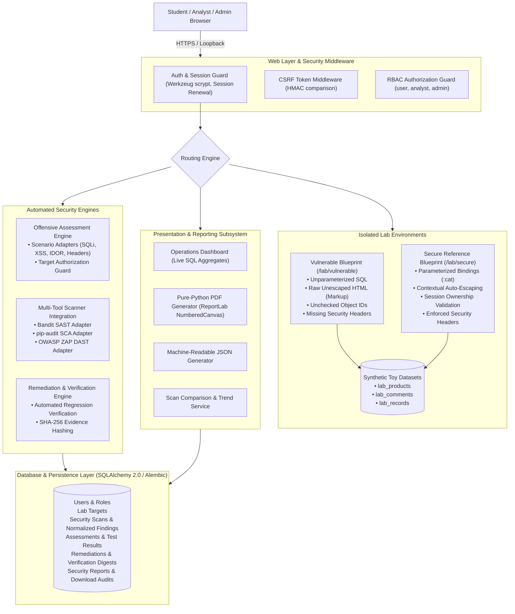
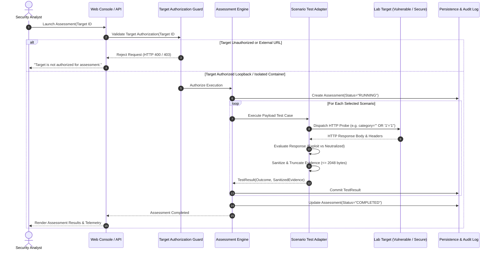
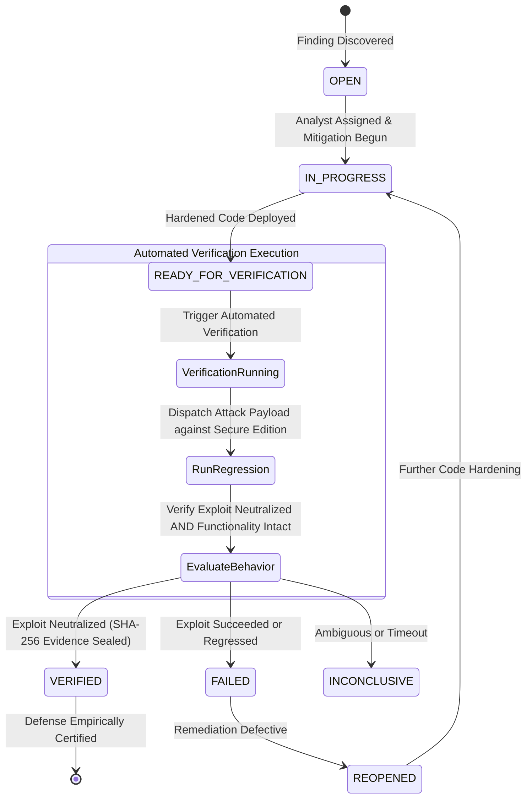

# VADL System Architecture & Component Interaction

## 1. High-Level Architectural Overview

The **Vulnerability Assessment and Defense Lab (VADL)** is organized into decoupled layers following the Flask application factory pattern:

---

## 2. Separation of Vulnerable & Secure Lab Applications

To ensure complete safety, the vulnerable training application is strictly isolated from production application infrastructure:

1. **Independent Blueprint Namespaces**:
   - `/lab/vulnerable/*`: Contains intentional vulnerabilities operating solely over synthetic datasets (`lab_products`, `lab_comments`, `lab_records`).
   - `/lab/secure/*`: Implements industry-standard mitigations (e.g., SQLAlchemy `:param` binding, Jinja auto-escaping, session-bound ownership guards).
2. **Environment Configuration Safety Gate**:
   - `check_lab_enabled()` executes before every request to `/lab/vulnerable/*`.
   - If `ENABLE_VULNERABLE_LAB` is `False` (the default in production), the blueprint returns HTTP 404.
   - If `ENABLE_VULNERABLE_LAB=true` is set alongside `FLASK_CONFIG=production`, the application factory aborts startup immediately with `ValueError`.
3. **Synthetic Dataset Isolation**:
   - Toy database tables do not contain real user credentials, live session identifiers, or administrative secrets.
   - Flags used in testing (e.g., `CONFIDENTIAL_LAB_FLAG{vadl_sqli_success}`) are synthetic strings created specifically for validation.

---

## 3. Offensive Assessment & Target Authorization Flow

---

## 4. Remediation & Automated Verification Workflow

The defensive remediation lifecycle prevents manual or unsubstantiated claims of vulnerability resolution:

---

## 5. Security Scanner Normalization Architecture

When automated tools (Bandit, pip-audit, OWASP ZAP) execute, their raw tool outputs are normalized into a canonical schema before database insertion:

1. **Tool Availability Detection**:
   - `detect_availability()` queries tool CLI binaries (`sys.executable -m bandit`, `pip-audit --version`, `docker info`).
   - If a tool is unavailable, structured execution errors are returned; scan results are never fabricated.
2. **Canonical Finding Schema (`NormalizedFinding`)**:
   - Mapped to standard severities (`CRITICAL`, `HIGH`, `MEDIUM`, `LOW`, `INFORMATIONAL`).
   - Mapped to CWE identifiers (e.g., `CWE-89`, `CWE-79`) and OWASP categories (`A03:2021-Injection`).
   - Technical evidence sanitized of terminal ANSI codes and truncated.
3. **Deterministic Deduplication**:
   - SHA-256 fingerprint generated from `(scanner_name, tool_finding_id, target_component, cwe_id)`.
   - Prevents duplicate findings across recurring scan runs; existing findings transition from `NEW` to `ACTIVE`, while resolved findings transition to `RESOLVED`.
