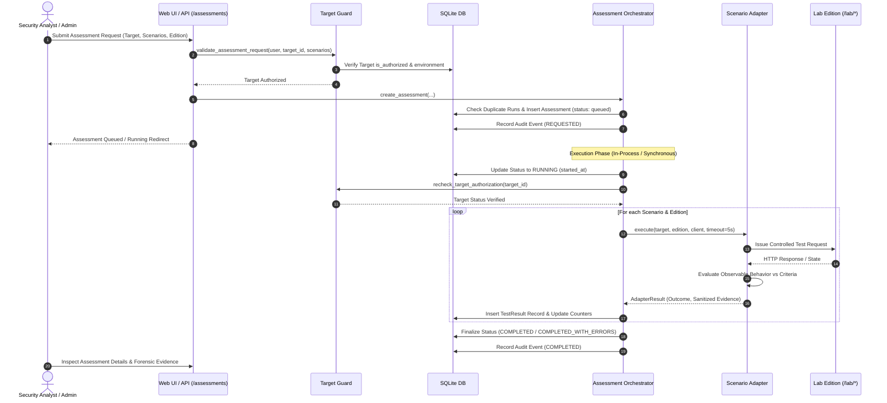

# VADL Offensive Security Testing Engine

## 1. Architectural Design & Execution Flow

The **VADL Offensive Security Testing Engine** (Phase 4) is an automated, controlled security assessment framework designed exclusively for evaluating explicitly authorized, internal laboratory scenarios.

Testing logic is strictly separated from Flask route handlers and organized into discrete, modular layers:
* **Target Authorization Guard** (`app/engine/target_guard.py`): Mandatory security boundary enforcing initiator roles, target allowlists, and pre-execution safety invariants.
* **Assessment Orchestrator** (`app/engine/orchestrator.py`): Manages the assessment lifecycle, duplicate submission prevention, timeouts, execution bounds, and transactional persistence.
* **Scenario Adapters** (`app/engine/adapters/`): Scenario-specific test adapters implementing deterministic, non-destructive attack simulations and defensive verifications.
* **Evidence Sanitizer** (`app/engine/evidence.py`): Bounded forensic capture with automated scrubbing of credentials, session cookies, and tokens.
* **Standardized Semantics** (`app/engine/semantics.py`): Strict taxonomy of test outcomes, error categories, and lifecycle states.



---

## 2. Assessment Lifecycle States

Assessments transition through an explicit state machine:

| Status | Description |
| :--- | :--- |
| `queued` | The assessment request has been validated, authorized, and placed in the execution queue. |
| `running` | The assessment is actively executing test adapters against target endpoints. |
| `completed` | All requested scenario adapters finished with definitive security evaluations and zero execution errors. |
| `completed_with_errors` | The assessment finished, but one or more test cases encountered an `ERROR` (e.g., target disabled, timeout, unexpected crash). |
| `failed` | The assessment could not proceed or terminated prematurely (e.g., target authorization was revoked while queued, unhandled engine fault). |
| `cancelled` | The assessment was safely cancelled by the initiator or an administrator before completion. |

> [!IMPORTANT]
> **No Ambiguous Security Claims**: An assessment containing execution errors is classified as `completed_with_errors` or `failed`. It is never reported as a clean or successful security assessment.

---

## 3. Strict Result Semantics

Individual test results adhere to a strict outcome vocabulary:

| Result Outcome | Semantic Definition |
| :--- | :--- |
| `VULNERABILITY_CONFIRMED` | A controlled test successfully reproduced the documented security weakness (e.g., SQL query altered, raw HTML rendered unescaped, cross-user private record accessed, security headers missing). |
| `SECURITY_CHECK_PASSED` | The relevant defensive control behaved as intended; the attack payload was neutralized or access was strictly denied (e.g., parameterized query prevented alteration, Jinja context-encoded HTML entities, HTTP 403 Forbidden returned, defensive headers verified). |
| `VULNERABILITY_NOT_REPRODUCED` | The expected weakness was not observed, but this does not prove the target is secure (e.g., filter blocked the test payload, but alternative vectors might exist). |
| `ERROR` | The test could not produce a trustworthy result due to a technical failure (e.g., HTTP 500 error, network timeout, connection refusal, or target disabled). |
| `NOT_APPLICABLE` | The test does not apply to the selected target configuration or edition. |

---

## 4. Supported Scenario Adapters

The engine maintains an explicit allowlist in [`app/engine/adapters/registry.py`](file:///c:/Users/HP/Downloads/Web Lab/app/engine/adapters/registry.py) mapping scenario IDs to dedicated adapter implementations. Dynamic Python module loading from user input is strictly prohibited.

```python
ADAPTER_REGISTRY: dict[str, type[BaseScenarioAdapter]] = {
    "VADL-SQLI-001": SQLInjectionAdapter,
    "VADL-XSS-001": XSSAdapter,
    "VADL-AC-001": IDORAdapter,
    "VADL-HEADERS-001": SecurityHeadersAdapter,
}
```

### A. SQL Injection Adapter (`VADL-SQLI-001`)
* **Test Payload**: Deterministic boolean tautology (`hardware' OR '1'='1`).
* **Vulnerable Edition**: Confirms query alteration via extraction of restricted toy test flags (`CONFIDENTIAL_LAB_FLAG`) or exposure of raw executed queries. Yields `VULNERABILITY_CONFIRMED`.
* **Secure Edition**: Confirms parameter binding (`:cat`); the tautology is evaluated as literal data, matching 0 catalog items. Yields `SECURITY_CHECK_PASSED`.
* **Safety Invariant**: Strictly read-only queries against toy SQLite tables. Destructive statements (`DROP`, `DELETE`, `UPDATE`) and arbitrary user SQL are prohibited.

### B. Cross-Site Scripting Adapter (`VADL-XSS-001`)
* **Test Payload**: Harmless synthetic markup (`<span id="vadl-xss-proof-..." class="vadl-test-indicator">XSS_POC</span>`).
* **Vulnerable Edition**: Confirms raw markup is rendered unescaped in DOM output (`markupsafe.Markup()`). Yields `VULNERABILITY_CONFIRMED`.
* **Secure Edition**: Confirms Jinja2 contextual auto-escaping converts tags to safe HTML entities (`&lt;span...&gt;`). Raw unescaped markup is absent. Yields `SECURITY_CHECK_PASSED`.
* **Safety Invariant**: Payloads carry non-destructive DOM markers; no credentials, cookies, or external scripts are invoked.

### C. Broken Access Control / IDOR Adapter (`VADL-AC-001`)
* **Test Cases**:
  1. Unauthorized cross-user request for confidential diagnostic note #2 (owned by `synthetic-user-2`).
  2. Unauthenticated anonymous request.
* **Vulnerable Edition**: Direct numeric primary key lookup returns HTTP 200 and leaks confidential data. Yields `VULNERABILITY_CONFIRMED`.
* **Secure Edition**: Verifies server-side ownership validation returns HTTP 403 Forbidden for non-owners and redirects anonymous users. Yields `SECURITY_CHECK_PASSED`.
* **Safety Invariant**: Operates strictly against synthetic test records in the isolated database; never bypasses core administrative auth.

### D. Security Headers Adapter (`VADL-HEADERS-001`)
* **Required Baseline**: `Content-Security-Policy`, `X-Content-Type-Options: nosniff`, `X-Frame-Options: DENY`, `Referrer-Policy`.
* **Vulnerable Edition**: Confirms absence of mandatory defensive headers. Yields `VULNERABILITY_CONFIRMED`.
* **Secure Edition**: Confirms all baseline headers are present with hardened configurations. Yields `SECURITY_CHECK_PASSED`.
* **Disclaimer**: The adapter explicitly documents that headers provide defense-in-depth, but do not alone prove an application is free of underlying flaws.

---

## 5. Target Authorization and Safety Boundaries

```mermaid
flowchart LR
    Request["Assessment Request"] --> CheckRole["1. Role Check (Analyst/Admin)"]
    CheckRole --> CheckTarget["2. Target DB Lookup"]
    CheckTarget --> CheckAuth["3. is_authorized == True"]
    CheckAuth --> CheckEnv["4. environment in (dev, test)"]
    CheckEnv --> CheckURL["5. Allowlist Hostname Check"]
    CheckURL --> CheckScen["6. Registered Scenarios Check"]
    CheckScen --> CheckLimits["7. Limit Bounds (<= 10 scenarios)"]
    CheckLimits --> CheckDup["8. Duplicate Check (Active Runs)"]
    CheckDup --> Queue["Queue Assessment"]
    Queue --> PreExec["9. Immediate Re-check before run"]
    PreExec --> Run["Execute In-Process"]

    CheckAuth -.->|Fails| Reject["Record AUTH_REJECTED Audit Event"]
    CheckEnv -.->|Fails| Reject
    CheckURL -.->|Fails| Reject
```



1. **Role Enforcement**: Initiating assessments requires active authentication with role `security_analyst` or `admin`. Ordinary users and anonymous visitors are rejected.
2. **Database Authorization**: Targets must exist in the database with `is_authorized = True`. Only administrators can toggle target authorization.
3. **Environment Boundary**: Targets must reside in approved lab environments (`development`, `testing`). Production targets are categorically rejected.
4. **Offline Lexical Allowlist**: Target URLs must match predefined lab hosts (`127.0.0.1`, `localhost`, `vadl-*`). Public IPs, external domains, and cloud metadata services (`169.254.169.254`) are rejected without network calls.
5. **Pre-Execution Re-Check**: If a target's authorization is revoked while an assessment is queued, the engine detects the change immediately before running, fails the assessment safely, and logs an `ERROR` result.

---

## 6. Execution Safety Limits

* **Max Scenarios**: Maximum 10 scenarios per assessment (`MAX_SCENARIOS_PER_ASSESSMENT`).
* **Test Timeout**: Default 5 seconds per individual test case (`TEST_TIMEOUT_SECONDS`).
* **Assessment Timeout**: Maximum 60 seconds total assessment duration (`MAX_ASSESSMENT_DURATION_SECONDS`).
* **Evidence Truncation**: Evidence storage is bounded to 4096 bytes per test (`MAX_EVIDENCE_BYTES`). Overflow is safely truncated with a visible indicator.
* **Duplicate Submission Prevention**: Re-submitting an identical assessment for the same target and scenarios while one is already active raises `DuplicateAssessmentError` (HTTP 409).
* **Sanitization**: All recorded request/response evidence is automatically scrubbed using regular expression filters targeting passwords, session cookies, CSRF tokens, and Authorization headers.

---

## 7. How to Run an Assessment Locally

### Method A: Interactive Web UI
1. Start VADL in development lab mode:
   ```powershell
   $env:FLASK_CONFIG = "development"
   $env:VADL_ENABLE_VULNERABLE_LAB = "true"
   python run.py
   ```
2. Navigate to `http://127.0.0.1:5000/login` and authenticate as a Security Analyst or Administrator.
3. Open `http://127.0.0.1:5000/assessments`.
4. In the **Launch Offensive Security Assessment** card:
   - Select the target (e.g., `Local Sandbox Instance`).
   - Choose target edition (`Both Editions`, `Vulnerable Only`, or `Secure Only`).
   - Check desired scenarios.
   - Click **Run Offensive Assessment**.
5. Inspect real-time status, test breakdown metrics, and click **Inspect Evidence** for any test result.

### Method B: Programmatic JSON API
Submit an authorized POST request with JSON payload:
```bash
curl -X POST "http://127.0.0.1:5000/assessments/run" \
  -H "Content-Type: application/json" \
  -H "Accept: application/json" \
  -H "X-CSRF-Token: <CSRF_TOKEN>" \
  -b "session=<SESSION_COOKIE>" \
  -d '{
    "target_id": 1,
    "target_edition": "both",
    "scenarios": ["VADL-SQLI-001", "VADL-XSS-001", "VADL-AC-001", "VADL-HEADERS-001"]
  }'
```

### Method C: Automated Test Suite
Run the Phase 4 engine test suites:
```powershell
pytest tests/test_engine_adapters.py tests/test_engine_orchestrator.py tests/test_engine_routes.py -v
```

---

## 7. Defensive Remediation and Verification (Phase 5)

Offensive assessment findings integrate seamlessly into the Phase 5 remediation workflow:
- Unremediated findings with outcome `VULNERABILITY_CONFIRMED` appear on the `/remediations` console.
- Analysts can create remediation tracks linked directly to originating test results.
- Automated verification reruns scenario-specific regression tests against secure targets.
- Comparative before-and-after diffs with cryptographic SHA-256 evidence digests can be viewed at `/remediations/<id>/compare`.
- For complete specifications, see [Defensive Remediation Workflow](file:///C:/Users/HP/Downloads/Web%20Lab/docs/remediation-workflow.md).

