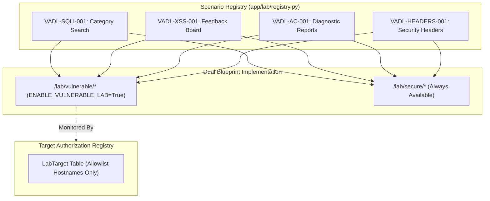

# VADL Vulnerability Lab Architecture & Reproduction Guide

## 1. Laboratory Architectural Design

The Vulnerability Assessment and Defense Lab (VADL) implements a dual-edition educational training pattern:
1. **Deliberately Vulnerable Lab Edition** (`/lab/vulnerable/*`): Houses intentionally flawed implementations of classic web application vulnerabilities using toy data and isolated models.
2. **Hardened Reference Edition** (`/lab/secure/*`): Implements industry-standard defensive controls for the exact same use cases, demonstrating concrete engineering remediations.

### Architectural Invariants & Isolation Controls

* **Independent Blueprints**: Vulnerable endpoints are mounted under `/lab/vulnerable` via `lab_vulnerable_bp`, completely separate from regular user profiles, authentication, and administrative routes.
* **Environment Guard**: The vulnerable blueprint installs a `before_request` hook (`check_lab_enabled()`) that evaluates `current_app.config.get("ENABLE_VULNERABLE_LAB")`. If `False`, any request to `/lab/vulnerable/*` immediately terminates with `HTTP 404 Not Found`.
* **Production Refusal Guarantee**: In `ProductionConfig.validate()`, if `ENABLE_VULNERABLE_LAB` is set to `True`, the application refuses startup and raises `ValueError("CRITICAL SECURITY VIOLATION: Vulnerable lab mode cannot be enabled in production environments.")`.
* **Isolated Data Schema**: All lab operations use dedicated SQLite tables (`lab_products`, `lab_comments`, `lab_records`) distinct from core application credentials (`users`). No production data or real personal identifiers are used.
* **Preserved Global Defenses**: Enabling the vulnerable lab does not disable CSRF protection, session fixation mitigation, or rate limiting on core routes.

---

## 2. Implemented Vulnerability Scenarios



---

### Scenario A: SQL Injection (VADL-SQLI-001)

* **Vulnerable Endpoint**: `GET /lab/vulnerable/sqli?category=<payload>`
* **Secure Endpoint**: `GET /lab/secure/sqli?category=<payload>`
* **CWE**: CWE-89 (Improper Neutralization of Special Elements used in an SQL Command)
* **OWASP**: A03:2021-Injection
* **Flaw Mechanism**:
  The vulnerable route constructs an SQL query via raw Python f-string interpolation:
  ```python
  raw_sql = f"SELECT id, name, category, description, price, is_secret_test_flag FROM lab_products WHERE category = '{category}'"
  db.session.execute(text(raw_sql))
  ```
  Crafted inputs breakout of the literal string delimiter and append custom SQL logic or bypass intended WHERE clauses.
* **Defensive Remediation**:
  The secure route binds all user input as data using SQLAlchemy parameterized queries:
  ```python
  stmt = text(
      "SELECT id, name, category, description, price, is_secret_test_flag "
      "FROM lab_products WHERE category = :category AND is_secret_test_flag = 0"
  )
  db.session.execute(stmt, {"category": category})
  ```
  The database engine treats the input strictly as literal string values, preventing semantic modification of the SQL statement.

#### Verification & Reproduction
```bash
# 1. Vulnerable edition: SQL tautology exposes secret test flag
curl -s "http://127.0.0.1:5000/lab/vulnerable/sqli?category=hardware'+OR+'1'='1" | grep -i "CONFIDENTIAL_LAB_FLAG"

# 2. Secure edition: Same tautology yields 0 results (input treated as literal string)
curl -s "http://127.0.0.1:5000/lab/secure/sqli?category=hardware'+OR+'1'='1" | grep -i "CONFIDENTIAL_LAB_FLAG"
```

---

### Scenario B: Stored Cross-Site Scripting (VADL-XSS-001)

* **Vulnerable Endpoint**: `POST /lab/vulnerable/xss`, `GET /lab/vulnerable/xss`
* **Secure Endpoint**: `POST /lab/secure/xss`, `GET /lab/secure/xss`
* **CWE**: CWE-79 (Improper Neutralization of Input During Web Page Generation)
* **OWASP**: A03:2021-Injection
* **Flaw Mechanism**:
  The vulnerable route wraps stored database content in `markupsafe.Markup()`, explicitly disabling Jinja2 contextual HTML escaping:
  ```python
  prepared_comments = [{"author": c.author_name, "content": Markup(c.content)} for c in comments]
  ```
  The client browser renders attacker-supplied HTML/JavaScript directly in the DOM.
* **Defensive Remediation**:
  The secure route relies on Jinja2 automatic HTML escaping and strips dangerous control characters. The template renders `{{ comment.content }}` which automatically converts `<` and `>` into safe HTML entities (`&lt;` and `&gt;`).

#### Verification & Reproduction
```bash
# 1. Post XSS payload to vulnerable endpoint:
curl -X POST "http://127.0.0.1:5000/lab/vulnerable/xss" \
  -d "author_name=Attacker&content=<script>alert('VADL-XSS')</script>"

# Output contains unescaped script tag:
curl -s "http://127.0.0.1:5000/lab/vulnerable/xss" | grep "<script>alert('VADL-XSS')</script>"

# 2. Post same payload to secure endpoint:
curl -X POST "http://127.0.0.1:5000/lab/secure/xss" \
  -d "author_name=Attacker&content=<script>alert('VADL-XSS')</script>&csrf_token=..."

# Output escapes HTML entities:
curl -s "http://127.0.0.1:5000/lab/secure/xss" | grep "&lt;script&gt;alert('VADL-XSS')&lt;/script&gt;"
```

---

### Scenario C: Insecure Direct Object Reference (VADL-AC-001)

* **Vulnerable Endpoint**: `GET /lab/vulnerable/records/<id>`
* **Secure Endpoint**: `GET /lab/secure/records/<id>`
* **CWE**: CWE-639 (Authorization Bypass Through User-Controlled Key)
* **OWASP**: A01:2021-Broken Access Control
* **Flaw Mechanism**:
  The vulnerable route fetches records by primary key alone, with no check confirming whether the requesting user owns the object:
  ```python
  record = LabRecord.query.get_or_404(record_id)
  return render_template("lab/vulnerable/record.html", record=record)
  ```
  Any user can iterate numeric record IDs to read records belonging to other participants.
* **Defensive Remediation**:
  The secure route enforces server-side ownership verification against the authenticated user session:
  ```python
  record = LabRecord.query.get_or_404(record_id)
  if record.owner_email != current_user.email and current_user.role != Role.ADMIN:
      abort(403, description="Forbidden: You do not own this diagnostic record.")
  ```

#### Verification & Reproduction
```bash
# 1. Vulnerable edition: Accessing user 2's private record returns 200 OK
curl -s "http://127.0.0.1:5000/lab/vulnerable/records/2" | grep "Diagnostic Record"

# 2. Secure edition: Accessing user 2's record as user 1 returns 403 Forbidden
curl -s -b cookies.txt "http://127.0.0.1:5000/lab/secure/records/2" # Returns HTTP 403
```

---

### Scenario D: Missing Defensive Security Headers (VADL-HEADERS-001)

* **Vulnerable Endpoint**: `GET /lab/vulnerable/headers`
* **Secure Endpoint**: `GET /lab/secure/headers`
* **CWE**: CWE-16 (Configuration), CWE-693 (Protection Mechanism Failure)
* **OWASP**: A05:2021-Security Misconfiguration
* **Flaw Mechanism**:
  The vulnerable route explicitly bypasses security response headers, omitting `Content-Security-Policy`, `X-Content-Type-Options`, `X-Frame-Options`, and `Referrer-Policy`. This leaves the client browser vulnerable to clickjacking (`<iframe>` embedding) and MIME-type sniffing.
* **Defensive Remediation**:
  The secure route explicitly enforces strict defensive HTTP response headers:
  * `Content-Security-Policy: default-src 'self'; frame-ancestors 'none'; ...`
  * `X-Content-Type-Options: nosniff`
  * `X-Frame-Options: DENY`
  * `Referrer-Policy: strict-origin-when-cross-origin`

#### Verification & Reproduction
```bash
# 1. Vulnerable headers: Missing all defensive headers
curl -I "http://127.0.0.1:5000/lab/vulnerable/headers"

# 2. Secure headers: Defensive headers present
curl -I "http://127.0.0.1:5000/lab/secure/headers"
```

---

## 3. How to Run Each Edition Locally

### Running the Hardened Reference Edition (Default Safe Mode)
By default, `ENABLE_VULNERABLE_LAB` is `False`. The vulnerable routes are disabled.
```bash
# Normal development startup
python run.py
```
Visiting `http://127.0.0.1:5000/lab/vulnerable` returns `HTTP 404 Not Found`.  
Visiting `http://127.0.0.1:5000/lab/secure` provides the hardened reference implementations.

### Running with the Vulnerable Laboratory Enabled
To enable the intentionally vulnerable routes for testing and demonstration:
```bash
# Windows PowerShell
$env:FLASK_CONFIG="development"
$env:VADL_ENABLE_VULNERABLE_LAB="true"
python run.py

# Linux / macOS Bash
export FLASK_CONFIG=development
export VADL_ENABLE_VULNERABLE_LAB=true
python run.py
```
Visiting `http://127.0.0.1:5000/lab/vulnerable` provides access to scenarios A through D.
